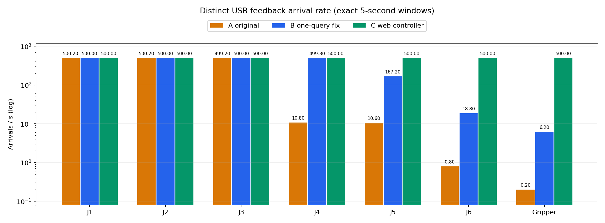
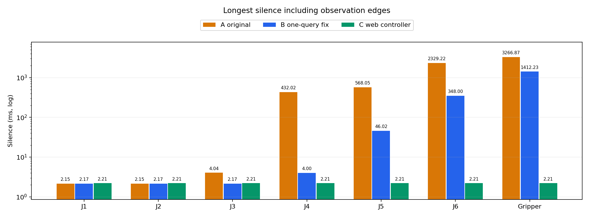

# Separate asynchronous feedback transport proposal

This is an independent proposal against main 93ed844, not the one-line query correction. It is ported from the previously built/tested D integration context (recorded historical branch b930fb4), preserving the serial/motor source semantics; original CRLF line endings are retained where used upstream. No controller algorithm, MIT gains, torque limits, gripper mapping or encoding formulas are changed.

## Scheduling and data path

- New command pending: send once, refresh from receive snapshots; do not issue an extra query.
- No new command at the 10 ms idle wake: query once; do not resend the previous MIT command.
- The receiver updates each motor's state/counter and steady-clock receive time under one mutex; the IO side reads a coherent copy.
- Serial empty reads are idle; fragmented frames are assembled; short writes are checked. Optional diagnostics use the same snapshots as the cache.

## Additional SDK policy changes needing review

This version also stops automatic destruction/rebuilding of shared motor/CAN objects after serial errors, latches communication fault and rejects further commands, delays the recovery worker until initialization completes, and adds owner-controlled pause/resume and ordered receiver/recovery shutdown. BRAKE logging distinguishes completed host writes from a device ACK. These lifecycle/error-recovery changes are part of the proposed diff and are **not** validated by the one-line B comparison.

The PR is proposed as a draft for transport/lifecycle review. Not every legacy SDK pointer reader is replaced by snapshots, and no unified feedback-TTL/automatic stop policy or device ACK is introduced. Tests below do not prove faulted hardware recovery or safe physical release. No current hardware is started, moved or released.

## Historical data (fixed 5.000 s HOLD windows)

A/B are the paired minimal-fix comparison; C is the separately authorized web transport run. SDK, gains, initial hold angle and acquisition time differ for C. Improvement cannot be assigned solely to deleting a send or solely to one asynchronous feature.

| Motor | A USB Hz | B USB Hz | C USB Hz | C longest silence incl. edges ms |
|---|---:|---:|---:|---:|
| J1 | 500.20 | 500.00 | 500.00 | 2.208 |
| J2 | 500.20 | 500.00 | 500.00 | 2.208 |
| J3 | 499.20 | 500.00 | 500.00 | 2.208 |
| J4 | 10.80 | 499.80 | 500.00 | 2.208 |
| J5 | 10.60 | 167.20 | 500.00 | 2.208 |
| J6 | 0.80 | 18.80 | 500.00 | 2.208 |
| Gripper | 0.20 | 6.20 | 500.00 | 2.208 |

C: 2500 MIT / zero extra queries / 2500 feedback protocol frames; every frame has all seven IDs once, each motor has 2500 distinct USB arrivals. Longest visible silence 2.208 ms; 50 ms-bin coverage 100%; capture kernel-drop=0. This is host-observed completeness in one short window, not an absolute CAN no-loss guarantee.

A run `20261030T075346Z-fiveages-MS-7E06-d2cec33ecd`; B run `20261030T075358Z-fiveages-MS-7E06-7e210f5575`; C run `20261030T081937Z-fiveages-MS-7E06-6a6961822d`.

The separate D integration retained upstream control/gains while adopting this transport: run `20261030T085851Z-fiveages-MS-7E06-e45dd75e9f`, seven motors each 2500 distinct arrivals/500 Hz, longest silence 2.184 ms, zero active queries, capture kernel-drop=0. Sparse SDK receive-age samples max 1.278 ms are not continuous worst-case latency or motor-internal sample time.

Machine-readable historical comparison is in `query-abc-data.json`; D results are in `d-hold-metrics.json`. No historical approval or ready flag is authorization for new hardware tests.

## No-device tests and limits

The proposed tests exercise real motor decoder snapshots with 10000 synthetic updates while reading concurrently, 500 command/10 idle dispatch decisions including a throwing send, and 128 serialized MIT frames (896 motor references). The packet byte stream is compared to an unchanged baseline separately. They never instantiate robot/serial_driver or a hardware plugin. They do not exercise actual USB, complete IO-thread wake timing, hot-plug, error worker or destructor release behavior.

Build with BUILD_TESTING=ON and run `ctest -R '(feedback_snapshot_oracle|packet_oracle)' --output-on-failure` in the package build directory. CTest targets each have a 30 s timeout. Current-run results are recorded separately from the historical real-HOLD observations.
